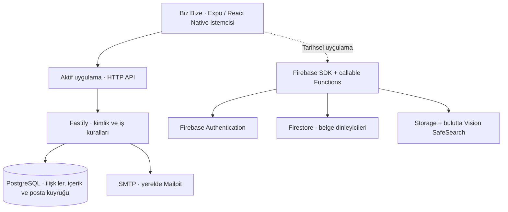

<div align="center">


# Biz Bize

**İki kişilik bir dünya, iki farklı backend mimarisi.**

Fotoğraflı anılar, sohbet, ortak görevler ve izinli konum paylaşımı sunan mobil uygulama;
Firebase ve bağımsız PostgreSQL backend uygulamalarını karşılaştıran bir yazılım mühendisliği çalışması.

**Proje sahibi ve geliştirici: Burak Şanlı**

[](https://github.com/sanlibrk/BizBize/actions/workflows/validate.yml)
[](LICENSE)

[Güncel backend](docs/BACKEND_EDITION.md) · [Firebase sürümü](docs/FIREBASE_EDITION.md) · [Karşılaştırmalı rapor](docs/CASE_STUDY.md) · [Dokümantasyon](docs/README.md) · [Hızlı başlangıç](#hızlı-başlangıç)

</div>

## Projenin odağı

Biz Bize, iki doğrulanmış kullanıcının davet koduyla eşleştiği özel bir ortak alan sunar. Harita, mesajlar ve albüm; aynı çiftin anıları, görevleri ve isteğe bağlı son konumu etrafında birleşir. Herkese açık akış veya rastgele eşleştirme bulunmaz.

Çalışmanın mühendislik odağı, aynı ürünün iki farklı backend yaklaşımıyla uygulanmasıdır: yönetilen kimlik/veri servisleriyle kurulan **Firebase sürümü** ve kimlikten veri silmeye kadar iş kurallarını uygulamanın üstlendiği **Fastify + PostgreSQL sürümü**. İki yaklaşımın kaynak kodu, güven sınırları, tutarlılık mekanizmaları ve işletim sorumlulukları birlikte incelenebilir.

Bu depo kişisel bir mühendislik vaka çalışmasıdır. Raporlar problem, yöntem, uygulama, doğrulama ve sınırlılıklar düzeninde hazırlanmıştır.

## İki uygulama, bir ana geliştirme hattı

| | Güncel uygulama | Firebase uygulaması |
|---|---|---|
| Kaynak | **Bu deponun `main` dalı** | [Firebase arşiv dalı](https://github.com/sanlibrk/BizBize/tree/archive/firebase) |
| Durum | **Aktif geliştirme; proje buradan devam eder** | Tarihsel uygulama; inceleme ve karşılaştırma için korunur |
| Backend | Fastify 5, Node.js, PostgreSQL 17 | Authentication, Firestore, callable Functions v2, Storage |
| Ayrıntılı inceleme | [Kendi backend sürümü](docs/BACKEND_EDITION.md) | [Firebase sürümü](docs/FIREBASE_EDITION.md) |
| Kurulum | [Güncel kurulum](docs/BACKEND_SETUP.md) | [Arşivdeki Firebase kurulumu](https://github.com/sanlibrk/BizBize/blob/archive/firebase/docs/FIREBASE_SETUP.md) |

İki sürüm aynı ürün alanını uygular; bütün teknik davranışları birebir aynı değildir. Firebase sürümünde belge dinleyicileri ve bulutta SafeSearch; güncel sürümde HTTP sorgulama, sunucuda görüntü decode etme ve üretimde insan incelemesi kullanılır. [Karşılaştırmalı rapor](docs/CASE_STUDY.md) bu tercihlerin etkilerini açıklar.

**Önceki Firebase projesi silinmez.** Hesaplar ve içerikler iki backend arasında otomatik taşınmaz. Sürümleri ayrı çalışma klasörlerinde incelemek için [sürüm rehberini](docs/VERSIONS.md) kullanın.

## Ürün kapsamı

| Alan | Güncel davranış |
|---|---|
| Hesap ve oturum | E-posta/şifre, altı haneli doğrulama kodu, şifre yenileme; web’de HttpOnly çerez, native’de SecureStore |
| İki kişilik alan | 24 saat geçerli tek kullanımlık davet; üyelik sınırı API ve SQL kısıtlarıyla uygulanır |
| Mesajlar ve görevler | Ortak sohbet, görev gönderme/tamamlama ve görevi anıya bağlama |
| Fotoğraflı anılar | Fotoğraf, not, tarih, yer ve koordinat; albüm/haritada aynı kayıt |
| Konum rızası | Başlangıçta kapalı; ön plan ve arka plan izinleri ayrı; son ölçüm, eski ölçüm uyarısı ve paylaşımı durdurma |
| Güven ve içerik | Özel fotoğraf erişimi, bildirim, partner engelleme ve üretimde fotoğraf inceleme kuyruğu |
| Veri yaşam döngüsü | Şifre onaylı hesap silme; ortak alanın ilişkili verilerinin transaction içinde kaldırılması |
| Örnek dünya | Hesap ve backend gerektirmeyen, örnek veri olduğu belirtilen yerel ürün önizlemesi |

## Mimariye genel bakış



Diyagram iki ayrı kaynak sürümünü karşılaştırır; güncel uygulama aynı anda iki backend’e yazmaz. Ortak istemci temeli Expo SDK 58, React Native, React ve TypeScript’tir. Native harita ve izinli konum akışlarıyla birlikte web önizlemesi için Leaflet kullanılır.

| Kaynak | Sorumluluk |
|---|---|
| `src/app`, `src/screens` | Rotalar ve ürün ekranları |
| `src/lib/backend.ts`, `src/lib/auth.ts` | Güncel HTTP/oturum ve hesap istemcisi |
| `src/lib/api.ts`, `src/store.tsx` | Ortak veri, önbellek ve uygulama durumu |
| `src/lib/location.ts` | İzinli konum görevi ve paylaşım bağlamı |
| `server/src`, `server/migrations` | API, yetkilendirme, SQL şeması, posta ve yönetim işlemleri |
| `server/tests`, `tests`, `scripts` | Entegrasyon, iş kuralı ve tarayıcı doğrulamaları |
| `docs` | İki sürümün raporları, kurulum, güvenlik ve yayın belgeleri |

## Hızlı başlangıç

**Aktif PostgreSQL sürümü** için Node.js 22.18+, npm ve çalışan Docker Desktop gerekir. Proje kökünde:

```powershell
npm ci
npm run backend:up
npm run web
```

| Adres | İşlev |
|---|---|
| http://localhost:8081 | Expo’nun web önizlemesi; terminalde gösterilen portu esas alın |
| http://localhost:3001/healthz | API sağlık kontrolü |
| **http://localhost:8025** | **Mailpit: yerel doğrulama ve şifre yenileme e-postaları** |

**Yerel kurulum Gmail’e e-posta göndermez.** Kayıt sonrasında kodu Mailpit’ten alın. `backend:up` API, PostgreSQL ve posta kutusunu başlatır; yerel sırları oluşturur ve API adresi yoksa `.env` dosyasına ekler. Mevcut farklı bir API adresini değiştirmez. İlk çalıştırma imaj indirme/derleme gerektirir.

İki kişilik akışı tek bilgisayarda normal ve gizli tarayıcı pencereleriyle deneyebilirsiniz: iki ayrı test hesabını doğrulayın, birinde davet oluşturun, diğerinde bu kodla eşleşin. `npm run backend:down` servisleri durdurur ve veritabanı volume’ünü korur. [Ayrıntılı kurulum ve sorun giderme](docs/BACKEND_SETUP.md).

## Doğrulama ve mühendislik kanıtı

[GitHub Actions](https://github.com/sanlibrk/BizBize/actions/workflows/validate.yml), gerçek PostgreSQL entegrasyonu, Docker/SMTP doğrulaması, iki oturumlu tarayıcı akışı, giriş ekranı regresyonu, TypeScript/lint ve web/iOS JS-varlık export kontrollerini çalıştırır. Kaynakta test bulunması ile belirli bir çalışmanın başarılı olması ayrı kanıtlardır; sonucu ilgili commit ile birlikte inceleyin.

```bash
npm run typecheck
npm run lint
npm test
npm run test:release
npm --prefix server run build
```

Backend entegrasyon testleri ayrıca ayrılmış test PostgreSQL’i gerektirir. [Test rehberi](TESTING.md), [değerlendirme yöntemi](docs/CASE_STUDY.md#değerlendirme-ve-kanıt-düzeyleri) ve [gerçek cihaz kabulü](IPHONE_TEST.md) ayrıntıları içerir. iOS export, imzalı uygulama veya Apple kabulü değildir.

## Bilinen sınırlar ve yayın durumu

Güncel sürüm ortak veriyi ön planda yaklaşık üç saniyede bir sorgular. Mesaj/anı listeleri 200 kayıtla, fotoğraflar çift başına 500 ile sınırlıdır; eski kayıtlar için sayfalama arayüzü henüz yoktur. Fotoğrafların PostgreSQL `bytea` alanında tutulması ve ortak mutasyonların global kilitle sıralanması küçük MVP’ye yönelik tercihlerdir. Mesajlar uçtan uca şifreli değildir.

**Yerel geliştirme ve otomatik kontroller mevcut; canlı bulut dağıtımı ve App Store yayını doğrulanmış değildir.** Üretimde HTTPS, gerçek e-posta sağlayıcısı, yedekleme/geri yükleme, izleme ve insan moderasyonu yapılandırılmalıdır. Barındırma hizmetinin uygun HTTPS adresi kullanılabilir; bağımsız alan adı satın almak her pilot kurulum için zorunlu değildir. Ücretsiz kotalar ve öğrenci kredileri kalıcı ücretsiz hizmet garantisi vermez.

[Güvenlik modeli](docs/SECURITY.md) · [Bağımlılık taraması](docs/DEPENDENCY_AUDIT.md) · [Moderasyon](docs/MODERATION.md) · [Yayın kontrol listesi](docs/RELEASE_CHECKLIST.md)

## Okuma yolları

- **Projeyi değerlendiren kişi:** [Mühendislik vaka çalışması](docs/CASE_STUDY.md) → [İki sürümün erişim rehberi](docs/VERSIONS.md).
- **Mimarileri inceleyen geliştirici:** [Firebase raporu](docs/FIREBASE_EDITION.md) ↔ [Kendi backend raporu](docs/BACKEND_EDITION.md).
- **Projeyi çalıştıran geliştirici:** [Kurulum](docs/BACKEND_SETUP.md) → [API](docs/API.md) → [Testler](TESTING.md).
- **Yayın hazırlığı:** [Gizlilik](docs/PRIVACY.md), [koşullar](docs/TERMS.md), [destek](docs/SUPPORT.md) ve [inceleme notları](docs/APP_REVIEW_NOTES.md).

[Dokümantasyon dizini](docs/README.md) · [Katkı rehberi](CONTRIBUTING.md) · [MIT lisansı](LICENSE)
