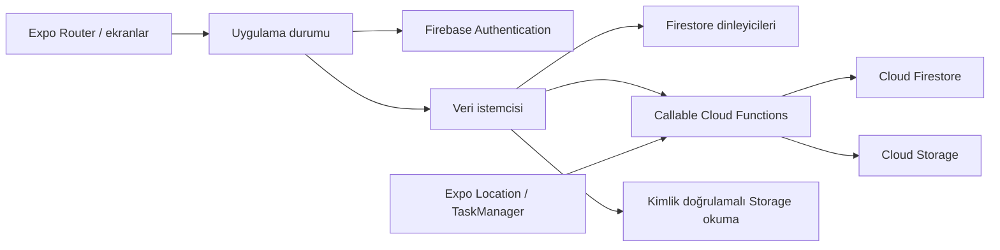

# Uygulama mimarisi

## İstemci ve servisler

Expo Router rotaları `src/app/` altında, ekran uygulamaları `src/screens/` altındadır. `src/store.tsx` oturum, önizleme ve ortak veriyi yönetir. `src/lib/firebase.ts` çalışma biçimini seçer:

- `preview`: Firebase yapılandırması olmadan yerel örnek dünya.
- `emulator`: `EXPO_PUBLIC_FIREBASE_USE_EMULATORS=1` ile yerel servisler.
- `cloud`: Beş genel Firebase alanıyla bulut bağlantısı.

## Veri modeli

| Yol | İşlev |
|---|---|
| `users/{uid}` | Çift kimliği, paylaşım rızası ve paylaşım sürümü |
| `couples/{cid}` | Üyeler, aktif/siliniyor durumu ve davet özeti |
| `couples/{cid}/messages/{id}` | Metin veya görev; tamamlama ve anı bağlantısı |
| `couples/{cid}/memories/{id}` | Fotoğraf yolu, tarih, not, yer ve koordinat |
| `couples/{cid}/locations/{uid}` | Kullanıcının son konumu ve ölçüm zamanı |
| `invites/{hash}` | Davet özeti, sahibi, sona erme ve kullanım durumu |
| `limits/{uid}` | Davet oluşturma/katılma hız sınırları |
| `cleanupJobs/{cid}` | Başarısız çift temizliğinin yeniden denenmesi |

Fotoğraf yolu `couples/{cid}/{uid}/{memoryId}.jpg` biçimindedir. Sunucu JPEG kontrolü ve 10 MB sınırı uygular. Fotoğraf callable işlemle yüklenir; istemci Storage SDK üzerinden oturumuyla okur ve bellekte data URI olarak tutar.

## Yetkilendirme

Firestore okumaları doğrulanmış e-posta ve aktif çift üyeliği gerektirir; kullanıcı kendi özel belgesini okuyabilir. Doğrudan istemci yazımları kapalıdır. Functions, Admin SDK kullandığından kimlik, üyelik ve girdi doğrulamasını kendisi yapar.

Davet kodu 6 rastgele bayttan üretilen 12 onaltılık karakterdir; sunucuda SHA-256 özeti saklanır. Geçerlilik 24 saat, katılım sınırı hesap başına 15 dakikada 5 deneme, oluşturma sınırı saatte 10 koddur. Üyelik değişiklikleri Firestore transaction içinde yapılır.

## Sunucu işlemleri

| Grup | Callable işlevler |
|---|---|
| Eşleşme | `createInvite`, `joinPair`, `disconnectPair` |
| Mesaj/görev | `sendMessage`, `completeTask` |
| Anı/fotoğraf | `uploadMemoryPhoto`, `discardUpload`, `addMemory`, `deleteMemory` |
| Konum | `setLocationSharing`, `publishLocation` |
| Hesap | `deleteAccount` |
| Güvenlik | `reportContent`, `blockPartner` |

Görevle anı ilişkilendirme transaction içinde yapılır. Fotoğraf yükleme ve Firestore kaydı ayrı adımlardır; kayıt başarısız olursa istemci `discardUpload` ile sahipsiz yüklemeyi kaldırmayı dener.

## Konum ve eşitleme

Konum istemcisi Expo Location ve TaskManager kullanır. Sunucu paylaşım rızası, çift kimliği, aktif iki kişilik üyelik ve paylaşım sürümünü denetler. Eski paylaşım oturumundan gelen callback yeni paylaşımı etkinleştiremez. Daha eski zamanlı ölçüm daha yeni kaydın üzerine yazılmaz.

Firestore `onSnapshot` dinleyicileri ortak veriyi taşır; bağlantı durumu arayüzde gösterilir. Mesaj ve anı sorguları en fazla 200 kayıt getirir. Fotoğraflar için bellekte önbellek bulunur; eşleşme değişiminde temizlenir.

## Silme ve erişimi kapatma

Eşleşme bitirilirken çift `deleting` durumuna alınır, davet kaldırılır ve iki üyenin çift/paylaşım alanları sıfırlanır. Ardından Storage dosyaları ve çift belge ağacı temizlenir. Hata oluşursa `cleanupJobs` kaydı kalır; işlem yeniden denenmelidir. Zamanlanmış otomatik temizlik işlevi bu kaynakta yoktur.

Hesap silme bu temizliğin ardından kullanıcı belgesini, hız sınırı kaydını ve Auth hesabını kaldırır. Silinen içeriğin cihazlara daha önce indirilmiş kopyaları geri alınamaz.

## Teknik kimliklerin korunması

Görünen marka **Biz Bize**'dir. `demo-yanyana`, Functions codebase adı ve bazı yerel depolama/görev anahtarları önceki teknik adları korur. Bunların topluca yeniden adlandırılması kayıtlı verileri, görevleri veya dağıtımı etkileyebilir; belge güncellemesinde değiştirilmez.

[README'ye dön](../README.md)

## İçerik güvenliği

Bulut fotoğraf yüklemesi, Storage kaydından önce Cloud Vision SafeSearch kontrolünden geçer. Raporlar istemciye kapalı `reports` koleksiyonunda, bildirim hız sınırları `reportLimits` altında tutulur. `blocks` kayıtları iki yönlü yeniden eşleşmeyi transaction içinde engeller. [İşletim ve sınırlar](MODERATION.md).
