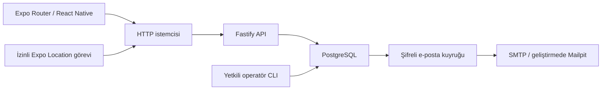

# Mimari · Kendi API’miz

Bu özet aktif `main` sürümünü açıklar. [İki mimarinin karşılaştırması](CASE_STUDY.md), [Firebase raporu](FIREBASE_EDITION.md) ve [güncel backend raporu](BACKEND_EDITION.md) aynı ürünün iki uygulamasını ayrıntılı inceler.

## Hesap ve oturum

Parolalar farklı rastgele salt ve scrypt N=32768/r=8/p=1 ile hash'lenir. Oturumlar kriptografik rastgele 256 bit opak anahtarlardır; veritabanında SHA-256 özetleri tutulur. Süre yedi gündür. Web'de HttpOnly/SameSite çerez (üretimde Secure), native'de SecureStore kullanılır. Şifre sıfırlama bütün oturumları iptal eder ve konum paylaşımını kapatır. Hesap silme mevcut şifreyi ister; doğrulanmamış hesap da silinebilir.

Altı haneli e-posta kodları kullanıcı ve amaca bağlı HMAC özetiyle saklanır. 15 dakika / en fazla beş deneme / tek kullanım uygulanır. Hatalı denemeler rollback ile kaybolmaz. E-posta kuyruğunun geçici içeriği AES-GCM ile şifrelenir; süreç SMTP hatasında yeniden dener, gizli kodları loglamaz.

## Veriler ve işlemler

`users`, `sessions`, `email_codes`, `mail_outbox`, `couples`, `members`, `invites`, `blocks`, `photos`, `memories`, `messages`, `locations`, `reports`, `rate_limits`, `audit_events` tabloları kullanılır. Tüm SQL değerleri parametrelidir.

Üyelik değişiklikleri ve ortak mutasyonlar transaction + ortak advisory lock ile sıralanır. `members` için kullanıcı başına tek üyelik, çift başına iki slot ve benzersizlik kısıtları vardır. Bu sade yöntem küçük MVP'de yarışları önler; yüksek yazma trafiğinde global kilit darboğaz olur ve çift bazında kilitleme tasarımı gerekir.

Çifti silmek fotoğraf, anı, mesaj ve konumları FK cascade ile aynı işlemde kaldırır; kullanıcıların çift kimlikleri null olur. Hesap silme ayrıca oturumları, kodları, posta kuyruğunu ve engelleme bağlantılarını kaldırır. Bildirimdeki hesap referansları null yapılır; kanıt metni en fazla kalan 30 günlük süresi boyunca tutulur.

## Fotoğraflar

İstemci en fazla 5 MB JPEG gönderir. Sunucu gerçek decoder ile görüntüyü açar; 20 MP sınırından sonra reddeder, EXIF dahil metadata'yı çıkartarak en fazla 1600×1600 JPEG'e yeniden kodlar. Özel PostgreSQL bytea alanında tutulur. Okuma endpoint'i her istekte aktif çift üyeliğini denetler; herkese açık dosya yolu veya kalıcı URL yoktur. Üretimde insan onayından önce fotoğraf ve bağlı anıyı yalnızca sahibi inceleme etiketiyle görebilir.

## Eşitleme ve konum

İstemci ön planda yaklaşık üç saniyede bir ortak veriyi yeniler; değişmemiş fotoğraflar bellekte tutulur ve aynı anda en fazla dört indirme yapılır. Çıkışta veya üyelik değişince önbellek temizlenir. Mesaj ve anılar 200 kayıtla, fotoğraflar çift başına 500 ile sınırlıdır. Gerçek çevrimdışı gönderim kuyruğu yoktur.

Konum yayınında kullanıcı rızası, aktif üyelik, paylaşım sürümü ve ölçüm zamanı doğrulanır. Durdurma sunucudaki konum kaydını siler, sürümü değiştirir. Eski callback paylaşımı geri açamaz. Sürekli konum geçmişi tutulmaz. Anı koordinatları ortak içerik olarak kalır.

## Sınırlar

Bu kaynak ağacı dağıtılmış ve güvenlik incelemesi tamamlanmış bir hizmet beyanı değildir. Yedekleme, SMTP teslimi, insan moderasyonu, HTTPS ve gerçek iOS kabulü operasyonel gereksinimlerdir. Mesajlar uçtan uca şifreli değildir.
