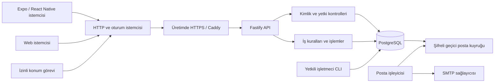
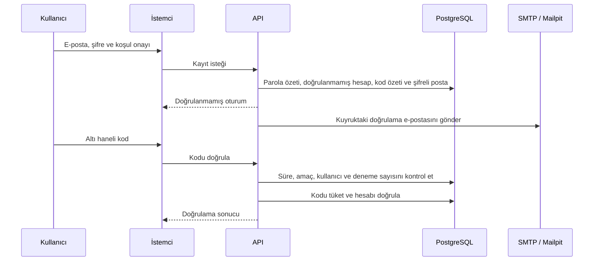

# Kendi backend’i ile Biz Bize

**Aktif geliştirme edisyonu · Expo / React Native + Fastify + PostgreSQL**

Bu rapor, Biz Bize’nin yönetilen Firebase servislerinden ayrı bir API ve ilişkisel veritabanı mimarisine taşınmasını kişisel bir yazılım mühendisliği vaka çalışması olarak ele alır. İnceleme konusu yalnızca kullanılan teknolojiler değil; kimlik, iki kişilik veri sahipliği, rıza, eşzamanlılık, içerik denetimi ve işletim sorumluluklarının hangi katmanda uygulandığıdır. Bu edisyon projenin devam eden ana uygulamasıdır. [Firebase edisyonu](FIREBASE_EDITION.md), aynı ürün probleminin önceki mimari çözümünü korur.

## 1. Problem ve tasarım hedefleri

Biz Bize, iki kullanıcının davetle katıldığı özel bir alanda mesaj, görev, fotoğraflı anı ve isteğe bağlı son konum paylaşımı sunar. Herhangi bir hesabın başka bir çiftin verisini okuyamaması; eşleşmenin iki üyeyi aşmaması; iptal edilen paylaşımın eski cihaz callback’leriyle tekrar açılmaması temel iş kurallarıdır.

Bu edisyonun hedefleri şunlardır:

- İstemcinin yalnızca tanımlı HTTP işlemlerine eriştiği bir servis sınırı kurmak.
- Kimlik ve ortak veri kurallarını API’de doğrularken veritabanı kısıtlarıyla da desteklemek.
- Yerel kurulumun veritabanı ve posta kutusuyla birlikte yeniden üretilebilmesini sağlamak.
- Kimlik ve parola işlemleri, üyelik yarışları ve veri silme gibi kritik davranışları gerçek PostgreSQL üzerinde sınamak.
- İşletim maliyetini ve bağımlılıkları görünür kılmak; özel backend kullanmanın barındırma, bakım ve e-posta maliyetlerini ortadan kaldırmadığını açıkça belirtmek.

Bu hedefler bir güvenlik sertifikası, performans üstünlüğü veya App Store kabulü iddiası değildir.

## 2. Sistem sınırları

Yerel geliştirmede Caddy yerine yalnızca loopback arayüzüne açılan API kullanılır; SMTP alıcısı Mailpit’tir. Mailpit, gerçek Gmail kutusuna gönderim yapmadan doğrulama ve parola yenileme akışlarını denemeyi sağlar. Üretim SMTP sağlayıcısı, doğrulanmış gönderici ve teslim testleri ayrı yapılandırılır.

| Katman | Sorumluluk | Kaynak |
|---|---|---|
| Rotalar ve ekranlar | Karşılama, hesap, eşleşme, harita, albüm, sohbet ve ayarlar | [src/app](../src/app), [src/screens](../src/screens) |
| Oturum ve HTTP | Native anahtar saklama, web çerezi, istek zaman aşımı, oturum olayları | [backend.ts](../src/lib/backend.ts) |
| Ortak veri istemcisi | İşlem çağrıları, sorgulama, fotoğraf önbelleği | [api.ts](../src/lib/api.ts) |
| İzinli konum | İşletim sistemi izinleri, takip bağlamı, paylaşım sürümü | [location.ts](../src/lib/location.ts) |
| API sınırı | CORS, istek boyutu, hata yanıtı, hız sınırları | [app.ts](../server/src/app.ts) |
| Kimlik ve posta | Parola, oturum, e-posta kodları ve gönderim kuyruğu | [auth.ts](../server/src/auth.ts), [mail.ts](../server/src/mail.ts) |
| Alan işlemleri | Davet, eşleşme, mesaj, fotoğraf, konum, rapor ve silme | [actions.ts](../server/src/actions.ts) |
| Kalıcılık | Tablolar, foreign key’ler, benzersizlik ve kontrol kısıtları | [İlk şema](../server/migrations/001_initial.sql) |

## 3. Hesap ve oturum yaşam döngüsü

Kayıt e-posta/şifre ve kullanım koşulu sürümünü alır. Parola uzunluğu 10–128 karakterle sınırlandırılır; parolanın kendisi saklanmaz. Sunucu her parola için rastgele salt üretir ve scrypt ile özet oluşturur. Karşılaştırmalar [güvenlik yardımcılarında](../server/src/security.ts) uygulanır.

Oturum anahtarı 256 bit rastgele opak bir değerdir. Sunucu yalnızca SHA-256 özetini saklar; oturum yedi gün geçerlidir. Web istemcisi anahtarı JSON yanıtından veya `localStorage` üzerinden yönetmez: HttpOnly, SameSite=Lax çerezi kullanır; üretimde Secure ve `__Host-` öneki uygulanır. Native istemci anahtarı SecureStore’da, cihazla sınırlandırılmış Keychain erişim seçeneğiyle tutar.

Kodlar 15 dakika geçerli, tek kullanımlık ve en fazla beş denemelidir. Kodun veritabanındaki HMAC özeti kullanıcı ve amaca bağlıdır; doğrulama kodu parola yenilemede kullanılamaz. Hatalı denemeler transaction geri alınırken kaybolmayacak şekilde tüketilir. Yeni kod eski kodu geçersiz kılar.

Kodun e-posta gövdesinde bulunması gerektiğinden geçici posta yükü AES-256-GCM ile şifrelenir. Posta işleyicisi başarısız gönderimlerde artan bekleme süreleriyle yeniden dener. Arayüzün kuyrukta, yeniden deneniyor ve sağlayıcı tarafından kabul edildi durumlarını ayırması, SMTP kabulünü gelen kutusuna teslimle karıştırmamayı amaçlar.

Parola sıfırlama bütün mevcut oturumları iptal eder, konum paylaşımını kapatır ve son konumu siler. Paylaşım güncellemelerinde yetkinin transaction içinde yeniden kontrol edilmesi, parola sıfırlamasıyla yarışan eski oturum isteklerinin sonradan veri yayınlamasını önlemeye yöneliktir.

## 4. İki kişilik üyelik ve veri modeli

`couples` ortak alanı, `members` ise kullanıcıların bu alandaki üyeliğini tanımlar. Kullanıcı kimliği üyelik tablosunun birincil anahtarıdır; böylece tek kullanıcı aynı anda birden fazla çifte üye olamaz. Slot değeri yalnızca 1 veya 2 olabilir; çift/slot çifti benzersizdir. Eşleşmenin iki kişiyle sınırlandırılması yalnızca ekran kontrolüne bırakılmaz.

| Veri grubu | Tablolar | Başlıca ilişki |
|---|---|---|
| Kimlik | `users`, `sessions`, `email_codes` | Oturum ve kodlar hesaba bağlıdır. |
| Eşleşme | `couples`, `members`, `invites`, `blocks` | İki slot, tek üyelik, süreli davet ve iki yönlü engel kontrolü vardır. |
| Ortak içerik | `messages`, `memories`, `photos` | Çift üyeliği ve yazar/sahip kimliğiyle yetkilendirilir. |
| Son konum | `locations` | Her kullanıcı için tek son ölçüm saklanır. |
| İşletim | `mail_outbox`, `rate_limits`, `reports`, `audit_events` | Gönderim, kötüye kullanım sınırları ve inceleme süreçleri desteklenir. |

Davet 12 hexadecimal karakterdir, veritabanında özeti tutulur ve 24 saat geçerlidir. Yeni davet önceki daveti kaldırır. Katılımda kendisiyle eşleşme, dolmuş alan, mevcut üyelik ve taraflardan birinin engelleme kaydı kontrol edilir. Başarılı katılım daveti tüketir.

Ortak değişiklikler transaction ve ortak advisory transaction lock ile sıralanır. Bu yöntem küçük MVP’nin eşleşme/silme yarışlarını sadeleştirir; bütün ortak işlemleri tek kilitte topladığı için yüksek eşzamanlılıkta darboğaz oluşturabilir. Çift başına kilitleme ve yük altında davranış, sonraki ölçekleme çalışmalarıdır; bu raporda ölçülmüş performans sonucu verilmez.

Mesaj gönderiminde istemcinin oluşturduğu kayıt kimliği, aynı işlemin tekrarlanmasında çoğaltmayı önler. Görevi anıya bağlama, anı oluşturma ve görev güncellemesini aynı veritabanı işlemi içinde yapar. Tarih, koordinat ve metin uzunlukları API ve uygun tablolardaki kontrol kısıtlarıyla sınırlandırılır.

## 5. Fotoğraf ve içerik inceleme akışı

Fotoğraflar herkese açık dosya URL’leri yerine PostgreSQL `bytea` alanında saklanır. Okuma endpoint’i her istekte geçerli hesap, aktif çift üyeliği ve inceleme durumunu denetler. Bu, küçük bir kurulumda içerik ile sahiplik bilgisinin birlikte yönetilmesini sağlar; yüksek hacimde veritabanı, yedekleme ve ağ yükünü artırır.

Yükleme en fazla 5 MB JPEG kabul eder. Dosya uzantısına güvenmek yerine Sharp ile gerçek görüntü decode edilir; 20 megapiksel sınırı uygulanır. Fotoğraf EXIF dahil metadata çıkarılarak en fazla 1600×1600 boyutlarında yeniden JPEG kodlanır. Eşzamanlı decode istekleri API’de sınırlandırılır.

Üretimde fotoğrafın başlangıç durumu `pending` olur. İnceleme bekleyen fotoğraf ve bağlı anı yalnızca sahibine inceleme etiketiyle görünür; partnere açılması operatör onayına bağlıdır. Yetkili CLI onay, ret, rapor çözme ve hesap devre dışı bırakma işlemlerini sağlar. Bu insan emeği gerektiren bir süreçtir; arayüzde bildirim düğmesi bulunması tek başına etkin moderasyon işletimi anlamına gelmez.

Yerel geliştirmede incelemeyi atlayan mod vardır; üretim yapılandırması bu modla başlamayı reddeder. Temel metin filtresi kapsamlı bir dil veya kötüye kullanım tespit sistemi olarak değerlendirilmez. Ayrıntılar: [Moderasyon](MODERATION.md).

## 6. Konum paylaşımında rıza ve geç ölçümler

Konum paylaşımı başlangıçta kapalıdır. Ön plan ve arka plan erişimi işletim sistemi izinleriyle ayrılır. Sunucuda paylaşımın etkin olduğu ve kullanıcının hâlâ ilgili çiftin üyesi olduğu ayrıca doğrulanır; cihaz izni tek başına sunucuya yayın yetkisi vermez.

Paylaşım açma/kapatma işlemi yeni bir sürüm kimliği üretir. Cihaz konum çağrıları bu sürümü taşır. Durdurma, çıkış, parola sıfırlama veya eşleşmenin kapatılması sonrasında eski sürümle gelen callback kabul edilmez. Ölçüm zamanları karşılaştırılır; eski ölçüm yeni konumu geriye götüremez ve aşırı ileri tarihli cihaz ölçümü reddedilir.

Sürekli rota geçmişi yerine tek son konum tutulur. Anı içine kullanıcı tarafından eklenen koordinat ise ortak içerikten ayrı bir canlı takip kaydı değildir; anı silinene veya ortak alan kapanana kadar içerikle birlikte kalır. Arka plan çalışma sıklığı iOS/Android, pil ve ağ koşullarına bağlıdır; kesintisiz GPS yayını garanti edilmez. Gerçek cihaz kabulü [iPhone test rehberinde](../IPHONE_TEST.md) ayrıca tanımlanır.

## 7. Eşitleme davranışı ve istemci sınırları

Ön plandaki istemci ortak veriyi yaklaşık üç saniyede bir HTTP ile sorgular. Arka planda sorgulama durur; uygulama yeniden etkin olduğunda yenileme tetiklenir. Bu uygulama Firebase dinleyicilerinin eşdeğer bir push altyapısı değildir: gecikme ve istek sayısı seçilen sorgulama aralığına bağlıdır.

Fotoğraflar istemci belleğinde önbelleğe alınır; aynı anda en fazla dört indirme yapılır. Oturum/üyelik değişiminde önbellek temizlenir. API bağlantı hatasında son veri ile bağlantı durumu ayrılır. Kalıcı çevrimdışı gönderim kuyruğu yoktur; bağlantısızken yazmanın ileride otomatik teslimi vaat edilmez.

Mesaj ve anı sorguları son 200 kayıtla, fotoğraf sayısı çift başına 500 ile sınırlandırılmıştır. Eski kayıtlar için sayfalama arayüzü henüz yoktur. Bu sınırlar ürün kapasitesini ve ölçekleme değerlendirmesini etkiler; sınırsız albüm/sohbet iddiası yapılmaz.

## 8. Güven sınırları ve silme semantiği

API Zod ile girdi doğrulaması, parametreli SQL, işlem/kullanıcı/IP bazında PostgreSQL destekli hız sınırları, web origin allowlist’i, HttpOnly çerez ve çapraz kaynak yazma kontrolleri uygular. Üretim API’si ayrı, superuser olmayan veritabanı rolü ister. Docker çalışma süreci root olmayan kullanıcıyla başlar. Bunların kapsamı [Güvenlik modeli](SECURITY.md) içinde açıklanır.

Hesap silme mevcut parolayı ister ve e-posta doğrulanmadan da kullanılabilir. Eşleşmenin kapatılması çiftin mesaj, anı, fotoğraf ve konumlarını foreign key cascade ile aynı işlemde kaldırır. Hesap silme ayrıca hesaba bağlı oturum, kod, posta ve diğer ilişkileri temizler. İçerik raporlarının hesap referansları null olabilir; rapor kanıtı süresi dolana kadar sınırlı süre tutulur. Raporlar 30 gün, operatör işlem kayıtları 90 gün sonunda temizlik işine girer.

Mesajlar **uçtan uca şifreli değildir**. API/veritabanı işletmecisi ve yetkili moderatör güven sınırının içindedir. Yedekler özel veriler içerir; silme davranışının yedeklerin saklama süresiyle birlikte açıklanması ve işletilmesi gerekir. [Gizlilik metni](PRIVACY.md) ve gerçek dağıtımın tutarlı kalması işletmeci sorumluluğudur.

## 9. Yeniden üretilebilir geliştirme ve işletim

Yerel Docker Compose; API, PostgreSQL 17 ve Mailpit’i birlikte başlatır. Yardımcı komut geliştirme sırlarını üretir; API ve posta kutusu bilgisayarın loopback adreslerine açılır. Kaynakta gerçek sır veya doğrulama kodu bulunması gerekmez. Kurulum: [Backend rehberi](BACKEND_SETUP.md).

Üretim şablonu özel ağdaki PostgreSQL/API ve dışarıya 80/443 üzerinden açılan Caddy reverse proxy’den oluşur. Ayrı yönetici/uygulama DB parolaları, posta kuyruğu şifreleme sırrı, HTTPS adresleri ve gerçek SMTP bilgileri sunucuda yapılandırılır. Şablonun bulunması canlı bir hizmetin dağıtıldığı anlamına gelmez.

Bu rapor hazırlanırken doğrulanmış bir canlı bulut dağıtımı, üretim SMTP teslim kabulü veya App Store yayını yoktur. Azure veya başka bir barındırıcı değerlendirmesi mimarinin dağıtım seçeneğidir; onaylanmış öğrenci kredisi ya da çalışan bulut sunucusu olarak sunulmaz. Sunucu erişimi, yamalama, yedekleme, geri yükleme, alarm ve moderasyon ek işlerdir.

## 10. Doğrulama stratejisi ve kanıt sınırları

| Doğrulama katmanı | Kaynak ve kapsam | Ne kanıtlamaz? |
|---|---|---|
| Güvenlik yardımcıları | [security.test.ts](../server/tests/security.test.ts): salt, parola karşılaştırma, HMAC/şifreli kuyruk, üretim varsayımları | Bağımsız penetrasyon testi veya sıfır açık |
| Gerçek PostgreSQL entegrasyonu | [api.test.ts](../server/tests/api.test.ts): yetki, izolasyon, kod denemeleri, eşleşme yarışı, decode, konum, engelleme ve silme | Üretim yükünde performans veya bütün saldırı senaryoları |
| Docker başlangıç testi | [Compose testi](../scripts/backend-compose-smoke.mjs): gerçek konteynerler, SMTP kutusu ve doğrulama kodu | Dış SMTP sağlayıcısının Gmail teslimi |
| İki oturumlu tarayıcı testi | [Backend tarayıcı testi](../scripts/backend-browser-test.cjs): kayıt, kod, eşleşme, mesaj, rapor ve engelleme | Gerçek iPhone izinleri ve arka plan GPS |
| Arayüz regresyonu | [Auth tarayıcı testi](../scripts/auth-browser-test.cjs): mobil/masaüstü genişlikleri, ekran geçişleri, çeviriye benzer DOM değişikliği | Gerçek çeviri servisinin bütün davranışları |
| İstemci kontrolleri | TypeScript, lint, iş kuralları/yayın testleri, web ve iOS JS/varlık export’u | İmzalı native uygulama kabulü veya Apple onayı |
| Yerel manuel kabul | Geliştiricinin iki ayrı tarayıcı oturumunda başarılı çalıştığını bildirdiği ürün akışları | Bağımsız saha testi veya cihaz laboratuvarı sonucu |

Otomasyon [GitHub Actions iş akışında](../.github/workflows/validate.yml) tanımlıdır; sonuçlar [Actions geçmişinde](https://github.com/sanlibrk/BizBize/actions) izlenebilir. Bir testin kaynakta bulunması her ortamda geçtiği anlamına gelmez; ilgili çalışmanın sonucu ve commit’i birlikte değerlendirilmelidir. Ayrıntılı çalıştırma adımları [Test rehberindedir](../TESTING.md).

## 11. Mühendislik değerlendirmesi ve devam çalışmaları

Bu edisyon, kimlikten silmeye kadar iş kurallarının uygulama tarafından açıkça sahiplenilmesini ve SQL kısıtlarıyla desteklenmesini gösterir. Aynı yaklaşım yönetilen servisin yaptığı birçok işi işletmeciye taşır. Değişim, yalnızca bağımlılık azaltımı değil; kontrol, geliştirme emeği ve işletim sorumluluğu arasında bir tercihtir.

Ölçek ve yayın öncesi çalışmalar arasında çift bazında eşzamanlılık tasarımı, sayfalama, bytea’dan ayrı nesne deposuna geçiş değerlendirmesi, ölçülmüş yük testi, sorgulama yerine olay tabanlı dağıtım seçeneği, üretim posta teslimi, yedekten geri yükleme, bağımsız güvenlik incelemesi ve gerçek iPhone kabulü bulunur. Bunlar tamamlanmış özellik veya elde edilmiş deneysel sonuç olarak sunulmaz.

**İlgili belgeler:** [API sözleşmesi](API.md) · [Mimari özeti](ARCHITECTURE.md) · [Güvenlik](SECURITY.md) · [Moderasyon](MODERATION.md) · [Yayın kontrol listesi](RELEASE_CHECKLIST.md) · [Firebase edisyonu](FIREBASE_EDITION.md)

## 12. Ücretsiz pilot dağıtım profili

Ana API ve PostgreSQL modeli korunarak Vercel Hobby/Neon Free için ayrı bir sunucusuz giriş eklendi. Bu profil DDL işlemini başlatma adımına taşır, küçük bağlantı havuzu kullanır, 3 MiB fotoğraf sınırı uygular ve istemci sorgulamasını 15 saniyeye çıkarır. Posta periyodik süreç yerine hesap isteklerine bağlı sınırlı işlenir; şifre yenilemede anonim kuyruk ilerletme isteği bulunur. Fiziksel saklama temizliği günlük ve özel bir cron anahtarına bağlıdır. Docker profilinin sürekli posta/temizlik süreçleri ve varsayılan sınırları korunur.

Bu uyarlama yerel/CI doğrulamasıyla değerlendirilebilir; gerçek Vercel dağıtımı, Neon hesabı, gerçek SMTP teslimi ve iPhone kabulü ayrıca gereklidir. Hobby kişisel/ticari olmayan kullanım şartı ve iki sağlayıcının kotaları ürün kapasitesini sınırlar. [Pilot kurulum rehberi](FREE_PILOT_DEPLOY.md).
