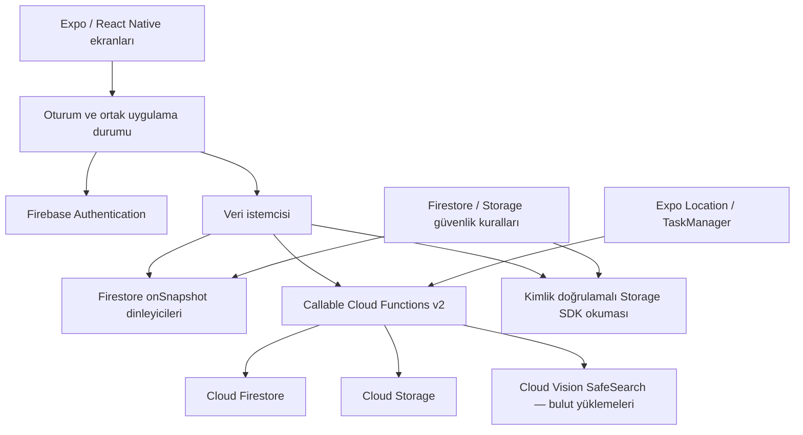

# Firebase sürümü · Tarihsel mimari incelemesi

Biz Bize'nin Firebase uygulaması, aynı iki kişilik ürünün yönetilen servislerle nasıl kurulabileceğini inceleyen ilk backend yaklaşımıdır. Bu belge, kişisel mühendislik çalışmasının **tarihsel uygulamasını** kaynak kod üzerinden açıklar. Ana geliştirme hattı [kendi backend sürümüdür](BACKEND_EDITION.md); Firebase sürümü karşılaştırma, öğrenme ve kod incelemesi için korunur.

| İnceleme noktası | Kaynak |
|---|---|
| Okunabilir arşiv dalı | [archive/firebase](https://github.com/sanlibrk/BizBize/tree/archive/firebase) |
| Belgenin dayandığı değişmez kaynak anlık görüntüsü | [Firebase kaynak sürümü](https://github.com/sanlibrk/BizBize/tree/0692aaa4a6a62ad3efbd6d29e54a9e24a2dc73a7) |
| Tarihsel paket sürümü | `0.1.0` |
| Tarihsel kurulum rehberi | [FIREBASE_SETUP.md](https://github.com/sanlibrk/BizBize/blob/0692aaa4a6a62ad3efbd6d29e54a9e24a2dc73a7/docs/FIREBASE_SETUP.md) |

Arşivde bulunması canlı bir Firebase projesinin dağıtılmış, ücretlendirmesinin yapılandırılmış veya mağazada yayımlanmış olduğunu göstermez. Kaynakta bulunan testler de bu belge güncellenirken yeniden çalıştırılmış test sonuçları olarak sunulmaz.

## İncelenen mühendislik problemi

Ürün, herkese açık bir sosyal ağ yerine iki doğrulanmış kullanıcının ortak alanını kurar. Temel sorular şunlardır:

- İstemciye ortak veriyi hızlı ulaştırırken üyelik ve yazma yetkisi nasıl sunucuda tutulur?
- İki kişiyle sınırlı eşleşme, aynı davete eşzamanlı katılımda nasıl korunur?
- Fotoğraf erişimi, bir dosya bağlantısını bilen herkesin erişebildiği modele dönüşmeden nasıl sağlanır?
- Konum izninin kaldırılması veya eşleşmenin bitmesi, geciken cihaz güncellemelerini nasıl geçersiz kılar?
- Farklı servislerdeki veriler silinirken erişim önce nasıl kapatılır, yarım kalan temizlik nasıl takip edilir?

Bu yaklaşımda istemci okuma ve dinleme için Firebase SDK'larını kullanır; kritik yazmalar kimlik ve üyelik denetimi yapan callable Functions üzerinden geçer.

## Bileşenler ve sorumluluklar



| Katman | Tarihsel uygulama |
|---|---|
| Arayüz | Expo SDK 58, React Native, TypeScript ve Expo Router; harita, sohbet, albüm ve hesap ekranları |
| Oturum | Firebase Authentication e-posta/şifre, doğrulama bağlantısı, şifre yenileme ve ID token değişikliklerini izleme |
| Veri okuma | Cloud Firestore belge/sorgu dinleyicileri; aktif kullanıcı ve çift değişince aboneliklerin yenilenmesi |
| İş kuralları | Node.js 22 üzerinde callable Cloud Functions v2; `europe-west1`, `maxInstances: 10` |
| Fotoğraf | Sunucudan Cloud Storage'a yükleme; oturumlu Storage SDK okuması ve istemcide bellek önbelleği |
| İçerik denetimi | Temel metin örüntü filtresi, bulutta Cloud Vision SafeSearch, özel bildirim kuyruğu ve operatör incelemesi |
| Yerel geliştirme | Authentication, Firestore, Storage ve Functions emülatörleri; ayrıca hesap gerektirmeyen örnek dünya |

İnceleme kaynakları: [Firebase bağlantısı](https://github.com/sanlibrk/BizBize/blob/0692aaa4a6a62ad3efbd6d29e54a9e24a2dc73a7/src/lib/firebase.ts), [veri istemcisi](https://github.com/sanlibrk/BizBize/blob/0692aaa4a6a62ad3efbd6d29e54a9e24a2dc73a7/src/lib/api.ts), [Functions](https://github.com/sanlibrk/BizBize/blob/0692aaa4a6a62ad3efbd6d29e54a9e24a2dc73a7/firebase/functions/src/index.ts).

## Belge tabanlı veri modeli

| Yol | İçerik ve görevi |
|---|---|
| `users/{uid}` | Kullanıcının çift kimliği, konum paylaşımı rızası ve paylaşım sürümü |
| `couples/{cid}` | Üye listesi, çiftin durumu, davet özeti ve oluşturulma zamanı |
| `couples/{cid}/messages/{id}` | Metin/görev türü, yazar, tamamlama zamanı ve anı bağlantısı |
| `couples/{cid}/memories/{id}` | Not, tarih, yer, koordinatlar, yazar ve özel fotoğraf yolu |
| `couples/{cid}/locations/{uid}` | Kullanıcının son ölçümü, ölçüm zamanı ve paylaşım durumu |
| `invites/{hash}` | Davetin SHA-256 özeti, sahibi, 24 saatlik süre sonu ve kullanım durumu |
| `limits/{uid}` | Davet oluşturma, katılma ve fotoğraf yükleme denemelerinin hız sınırı kayıtları |
| `cleanupJobs/{cid}` | Çift erişimi kapatıldıktan sonra tamamlanması gereken silme işlemi |
| `reports/{id}` | Bildiren/hedef hesap, bildirim türü, sınırlı metin kanıtı, inceleme durumu ve süre sonu |
| `reportLimits/{uid}` | Hesap başına bildirim denemeleri |
| `blocks/{hash}` | İki hesap arasında yeniden eşleşme denetiminde kullanılan engelleme kaydı |

Mesaj ve anı sorguları en fazla 200 kayıt getirir. Bu, bir veri getirme sınırıdır; eski kayıtlar için sayfalama arayüzü bu tarihsel uygulamada bulunmaz. Konum modeli rota geçmişi değil, kullanıcı başına son ölçümü tutar.

## Hesap ve oturum akışı

Kayıt sırasında Firebase Authentication hesabı oluşturulur ve `sendEmailVerification` çağrılır. Kullanıcı e-postadaki işlem bağlantısını tamamladıktan sonra uygulama kullanıcı kaydını yeniler ve yeni ID token ister. Ortak alan işlemlerinde sunucu `email_verified` iddiasını kontrol eder. Şifre yenileme de Firebase'in e-posta işlem bağlantıları üzerinden yürütülür; güncel backend'in altı haneli kod akışıyla aynı değildir.

Native oturum kalıcılığı, SecureStore'un anahtar kısıtlarını karşılayan kodlama ve 1.800 karakterlik parçalarla uygulanır. Web tarafında Firebase'in `browserLocalPersistence` yöntemi kullanılır. Güncel backend'in tarayıcı için HttpOnly cookie modelinden bu noktada ayrılır.

Bağlantı modları üçe ayrılır: yapılandırma yoksa `preview`, açık emülatör ayarı varsa `emulator`, genel Firebase yapılandırması tam ise `cloud`. Emülatör adresleri istemcide yerel adreslerle sınırlandırılmıştır; arşivdeki istemciyi bilgisayarın LAN IP'sine yönlendirmek desteklenen bir ayar değildir.

Kaynak: [Auth işlemleri](https://github.com/sanlibrk/BizBize/blob/0692aaa4a6a62ad3efbd6d29e54a9e24a2dc73a7/src/lib/auth.ts).

## İşlem sınırları ve tutarlılık

### Davet ve iki kişilik eşleşme

Davet 6 rastgele bayttan üretilen 12 onaltılık karakterdir; açık kod yerine SHA-256 özeti saklanır. Kod 24 saat geçerlidir, yenisi eskisini iptal eder. Oluşturma sınırı hesap başına saatte 10, katılma sınırı 15 dakikada 5 denemedir. Başarısız katılma denemelerinde hız sınırı kaydının transaction ile gerçekten yazılması için sonuç hata alanıyla döndürülür; transaction içinden exception atılarak sayaç geri alınmaz.

Katılma transaction'ı kullanıcının mevcut eşleşmesini, davetin durumunu, tek üyeli aktif çifti ve iki yönlü engelleme kayıtlarını okur. Üyelik güncellemesi ve davetin kullanılmış olarak işaretlenmesi aynı transaction içinde yapılır. Eşzamanlı iki isteğin çifti üç kişiye çıkarmaması hedeflenir ve buna karşı emülatör testi bulunur.

### Mesaj, görev ve anı

Mesaj/görev yazma, tamamlanmış iki kişilik aktif üyelik gerektirir. İstemcinin ürettiği UUID aynı kullanıcı tarafından tekrar gönderilirse yeni kayıt çoğaltılmaz. Metin uzunlukları sunucuda sınırlanır. Görev tamamlama ve görevden anı oluşturma ilişkisi Firestore transaction içinde güncellenir.

Fotoğraf yükleme ile anı belgesinin yazılması farklı servislerde iki adımdır. Anı yazılamazsa istemci `discardUpload` ile sahipsiz dosyayı kaldırmayı dener. Bu telafi akışı servisler arasında tek bir atomik transaction olduğu anlamına gelmez.

### Sunucu işlem yüzeyi

| Grup | Callable işlemler |
|---|---|
| Eşleşme | `createInvite`, `joinPair`, `disconnectPair` |
| Mesaj/görev | `sendMessage`, `completeTask` |
| Fotoğraf/anı | `uploadMemoryPhoto`, `discardUpload`, `addMemory`, `deleteMemory` |
| Konum | `setLocationSharing`, `publishLocation` |
| Hesap | `deleteAccount` |
| Bildirim ve engelleme | `reportContent`, `blockPartner` |

## Fotoğraf erişimi ve moderasyon

Fotoğraf yolu `couples/{cid}/{uid}/{memoryId}.jpg` biçimindedir. İstemci doğrudan Storage'a yazamaz; callable işlem dosya sahipliğini sunucuda belirler. Kaynakta JPEG başlangıç baytları ve **10 MB** boyut sınırı kontrol edilir. Bu kontrol tam bir görüntü decoder'ı ve yeniden kodlama işlemi değildir; transport sınırları ve base64 ek yükü de dikkate alınmalıdır. Güncel backend'in Sharp ile decode/metadata temizleme yaklaşımıyla aynı güvenceyi verdiği ileri sürülmez.

Gerçek bulut yüklemesinde dosya kaydedilmeden önce Cloud Vision SafeSearch çağrılır. `adult`, `violence` veya `racy` sonucu `LIKELY` / `VERY_LIKELY` ise yükleme reddedilir. Yanıt eksikse, servis erişilemiyorsa veya istek başarısızsa yükleme durur. Bu davranış güvenlik kontrolü başarısızken yayınlamama ilkesidir; tüm zararlı içeriğin otomatik yakalandığı iddiası değildir. Emülatör, örnek test fotoğraflarını dış servise göndermez ve bu çağrıyı atlar.

Storage dosyaları `private, no-store` ile yazılır. Kalıcı paylaşılabilir indirme token'ı üretmek yerine oturumlu SDK okumaları kullanılır; anı oluşturulurken download-token metadatası temizlenir. Bir dosya yolunu bilmek erişim yetkisi sağlamaz. Cihaza önceden indirilmiş içeriği geri almak ise mümkün değildir.

Bildirimler partner mesajı, anısı veya hesabı için oluşturulabilir. Günde 10 bildirim sınırı uygulanır. Kanıt kaydına fotoğraf veya hassas GPS kopyalanmaz; içerik kimliği ve ilgili sınırlı metin alınır. Bildirimler istemciye açık değildir. `expires_at` alanı 30 gün sonrasına yazılır; otomatik saklama süresi için ayrıca Firestore TTL etkinleştirilmelidir.

Tarihsel [moderasyon yardımcısı](https://github.com/sanlibrk/BizBize/blob/0692aaa4a6a62ad3efbd6d29e54a9e24a2dc73a7/firebase/functions/moderation.mjs) açık bildirimlerin metnini dökmeden özetlerini listeler ve bildirimi çözüldü olarak işaretleyebilir. Bu işlem tek başına içeriği kaldırmaz veya hesabı askıya almaz; insan operasyonu ayrıca gerekir.

## Konum rızası ve geciken ölçümler

İstemci Expo Location ile gerçek ölçüm alır; arka plan paylaşımı için ayrı izin ve TaskManager akışı bulunur. Sunucu konum güncellemesini kabul etmeden önce rıza, paylaşım sürümü, çift kimliği, aktif iki kişilik üyelik ve ölçüm zamanını denetler. Önceki paylaşım oturumundan gelen güncelleme yeni sürümle uyuşmadığında reddedilir; daha eski ölçüm, daha yeni ölçümü ezmez.

Paylaşım kapatıldığında sürüm değiştirilir ve son konum belgesi `sharing: false` ile sıfır koordinatlara çevrilir. Bu tarihsel davranış, güncel backend'in konum satırını kaldırmasıyla karıştırılmamalıdır. Arka plan konumunun zamanlamasını işletim sistemi, pil, izinler ve bağlantı koşulları belirler; sürekli takip veya sabit aralık garantisi yoktur.

Kaynak: [Konum istemcisi](https://github.com/sanlibrk/BizBize/blob/0692aaa4a6a62ad3efbd6d29e54a9e24a2dc73a7/src/lib/location.ts).

## Yetkilendirme ve silme

[Firestore kuralları](https://github.com/sanlibrk/BizBize/blob/0692aaa4a6a62ad3efbd6d29e54a9e24a2dc73a7/firebase/firestore.rules), doğrulanmış kullanıcıya yalnızca kendi kullanıcı belgesini ve aktif üyesi olduğu çiftin izinli koleksiyonlarını okutur. [Storage kuralları](https://github.com/sanlibrk/BizBize/blob/0692aaa4a6a62ad3efbd6d29e54a9e24a2dc73a7/firebase/storage.rules) aynı üyelik denetimini özel dosya okumalarına uygular. İstemci yazmaları iki yerde de kapalıdır. Admin SDK bu kuralları aşabildiğinden Functions içindeki kimlik, üyelik ve girdi doğrulamaları ayrı bir güven sınırıdır.

Eşleşme kapatılırken çift `deleting` durumuna alınır, iki kullanıcının çift/rıza alanları sıfırlanır, davet kaldırılır ve `cleanupJobs` kaydı yazılır. Böylece dosya temizliği başarısız olsa bile aktif ortak erişim kapanır. Ardından Storage dosyaları, çiftin belge ağacı ve temizlik kaydı silinir. Otomatik zamanlanmış yeniden deneme işçisi bu kaynakta yoktur; başarısız temizlik kullanıcı işleminin tekrarı veya operatör takibi gerektirir.

Engelleme bu erişim kapatma akışına ek olarak yeniden eşleşmede her iki yönde denetlenen bir kayıt oluşturur. Hesap silme, doğrulanmamış hesabın da hesabını kaldırabilmesine izin verir; çift temizliğinden sonra kullanıcı, hız sınırı ve Auth hesabını kaldırır. Tarihsel callable hesap silme kodu, güncel backend'in mevcut şifreyi tekrar isteme akışıyla eşdeğer değildir.

## Test yaklaşımı ve kanıtın sınırları

Tarihsel [Firebase entegrasyon testi](https://github.com/sanlibrk/BizBize/blob/0692aaa4a6a62ad3efbd6d29e54a9e24a2dc73a7/tests/firebase.test.ts), gerçek Firebase SDK'larını yerel Auth/Firestore/Storage/Functions emülatörlerine bağlayan senaryolar içerir:

- Anonim/doğrulanmamış hesap reddi ve üçüncü kişinin çift verisine erişememesi.
- Doğrudan üyelik/konum/Storage yazmalarının reddedilmesi.
- Davet yenileme, tek kullanım, eşzamanlı katılım ve hatalı deneme sınırı.
- Mesajın SDK dinleyicisine ulaşması ve yinelenen isteğin kayıt çoğaltmaması.
- Özel fotoğraf erişimi, token metadatasının temizliği ve görev-anı ilişkisi.
- Konum rızası, zaman sırası ve paylaşım sürümü.
- Özel bildirim, iki yönlü engelleme, eşleşme temizliği ve hesap silme.

[İçerik filtresi testleri](https://github.com/sanlibrk/BizBize/blob/0692aaa4a6a62ad3efbd6d29e54a9e24a2dc73a7/tests/content-safety.test.mjs) örnek metinleri ve SafeSearch yanıt sınıflandırmasını sınar. Bunlar canlı Vision servisinin doğruluk testi değildir. Fotoğraf emülatör testinde yalnızca dört JPEG işaret baytı kullanılması, gerçek fotoğraf decoder veya üretim fotoğraf yükleme kabulünün kanıtı sayılamaz.

Emülatör testinin gerekli ortamı yoksa ilgili test atlanır. Dolayısıyla yalnızca genel test komutunun bitmesi tüm Firebase entegrasyonunun sınandığını göstermez. Bulut dağıtımı, gerçek e-posta teslimi, Vision yetkileri, fiziksel iPhone konumu ve mağaza incelemesi ayrıca doğrulanmalıdır. Bu belgenin hazırlanması sırasında arşiv bağımlılıkları kurulup tarihsel testler yeniden çalıştırılmamıştır.

## Kurulumu yeniden üretme ve maliyet sınırı

Arşivi ayrı bir çalışma klasöründe incelemek için:

```bash
git clone --branch archive/firebase --single-branch https://github.com/sanlibrk/BizBize.git BizBize-Firebase
cd BizBize-Firebase
npm ci
npm --prefix firebase/functions ci
npm --prefix firebase/functions run build
npm run test:firebase
```

Emülatörler için tarihsel rehberdeki Node/Java gereksinimlerini kontrol edin. Yerel Auth emülatörü gerçek Gmail'e doğrulama e-postası göndermez; işlem bağlantısını emülatör çıktısından alırsınız. Buluta geçerken kullanıcıya ait proje, doğru güvenlik kuralları/indeksler, Auth sağlayıcısı, Storage, Functions ve Vision yetkileri ayrıca yapılandırılır. Arşiv bağımlılıklarının bugün bakım altında veya güncel güvenlik taramasından geçmiş olduğu varsayılmamalıdır.

Maliyet yalnızca kullanıcı sayısından oluşmaz: Firestore okumaları/yazmaları, konum sıklığı, fotoğraf saklama/indirme, Function süresi ve Cloud Vision çağrıları birlikte değerlendirilir. Cloud Storage ve Functions için güncel faturalandırma gereksinimleri vardır; ücretsiz kullanım kotaları sıfır fatura garantisi değildir. Geçişin gerekçesi, Firebase'in kesin bir başlangıç ücreti olduğu iddiası değildir. Güncel plan ve bölge koşulları [Firebase fiyatlandırmasından](https://firebase.google.com/pricing) kontrol edilmelidir.

## Bu uygulamanın çalışmaya katkısı

Firebase sürümü; yönetilen kimlik, belge tabanlı transaction'lar, güvenlik kuralları, olay temelli istemci eşitlemesi ve servisler arası telafi işlemlerini somutlaştırır. Güncel backend ise bu sorumlulukların SQL kısıtları, uygulama sunucusu, kendi oturum modeli ve işletim süreçleriyle nasıl yeniden kurulduğunu gösterir. İki uygulama aynı ürün alanını karşılaştırmak için saklanır; eşdeğer performans, maliyet veya güvenlik düzeyi ölçüldüğü ileri sürülmez.

[Ana projeye dön](../README.md) · [Güncel backend incelemesi](BACKEND_EDITION.md)
